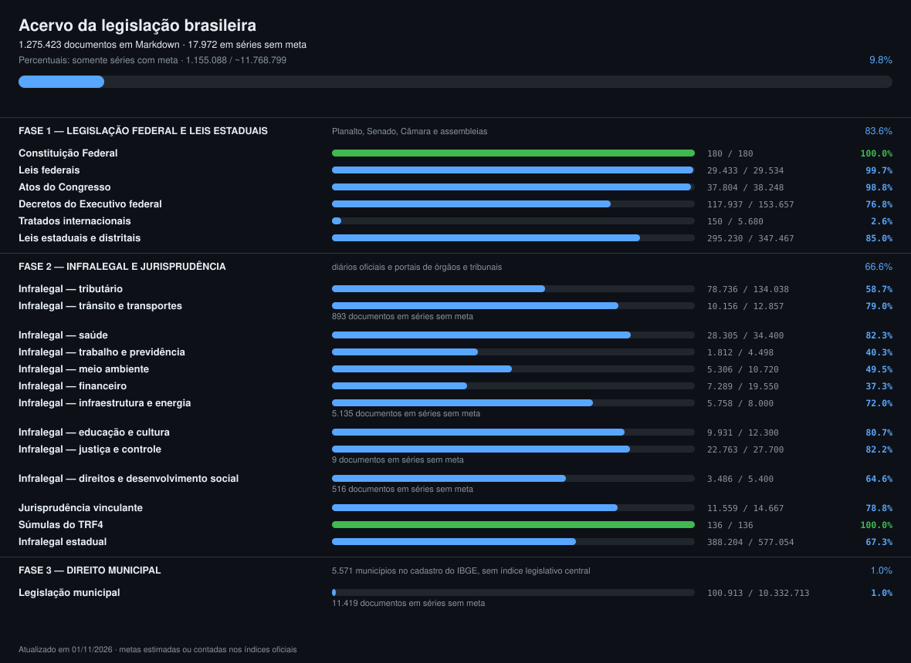

# Legislação brasileira em Markdown

Normas brasileiras convertidas de fontes oficiais para Markdown, cada uma com cabeçalho
estruturado e link para a origem do texto: a Constituição Federal, a legislação federal,
estadual, distrital e municipal, atos de órgãos reguladores e jurisprudência vinculante, num
lugar só, em texto simples e de graça.

Mantido por **[Vinícius Andrade](https://github.com/viniciusdsandrade)** · [devandrade.tech](https://devandrade.tech)

[](PROGRESSO.md)

> [!IMPORTANT]
> Os textos têm caráter informativo e **não substituem a publicação oficial**. São conversões
> automáticas, parte delas por OCR de documentos escaneados. Confira sempre a fonte indicada no
> cabeçalho antes de citar.

---

## O acervo

Em 06/11/2026 eram **1.348.337 documentos**. As contagens por série, com meta, fonte e pasta,
são regeneradas a cada commit em **[PROGRESSO.md](PROGRESSO.md)**, a partir do escopo definido em
[`scripts/plano.py`](scripts/plano.py).

| Fase | Escopo | Documentos | Cobertura da meta |
| --- | --- | ---: | ---: |
| 1 | Legislação federal e leis estaduais | 487.075 | 83,6% |
| 2 | Infralegal e jurisprudência | 745.845 | 74,5% |
| 3 | Direito municipal | 115.417 | 1,0% |
| | **Total** | **1.348.337** | |

[COBERTURA.md](COBERTURA.md) traz os números por esfera e tipo, com as lacunas.
[estatisticas.html](estatisticas.html) reúne gráficos sobre o acervo num arquivo único, que abre
no navegador sem servidor.

---

## Progresso desde outubro de 2026

Desde 21/10/2026 o acervo cresce por pull requests neste repositório, cada lote auditado antes
do commit. Até 06/11/2026 foram 52 pull requests mesclados, com **112.474 normas novas**
coletadas e conferidas aqui, além de 34.020 normas de colaboradores, revisadas e integradas
(veja [Contribuições integradas](#contribuições-integradas)).

| Frente | O que entrou | Pull requests |
| --- | --- | --- |
| **Campinas (SP)** | 42.615 normas, do SAPL da Câmara e da Biblioteca Jurídica da Prefeitura: 16.776 leis ordinárias (1893 a 2026), 598 leis complementares, a Lei Orgânica e 54 emendas, 17.832 decretos (1931 a 2026), 6.306 decretos legislativos (1967 a 2026), 1.042 resoluções da Câmara (1903 a 2026), plano diretor e código tributário | #6 a #28, #31, #32, #34, #35, #39 a #41 |
| **Estado de São Paulo** | 69.827 normas da ALESP: 68.320 decretos (1889 a 2008 e 25 de 2026), 1.456 resoluções (1867 a 2007), 43 decretos legislativos, 6 constituições históricas e 2 emendas constitucionais históricas | #30, #33, #37, #38, #42, #45 a #54 |
| **CONTRAN** | Resoluções 1.032 e 1.033 de 2026, do Diário Oficial da União | #29 |
| **Nova Friburgo (RJ)** | Lei Orgânica e 29 emendas, do SAPL da Câmara, no lugar de uma versão colada sem cabeçalho nem fonte | |
| **Qualidade** | auditoria do acervo e testes no CI; correções de padrão nos lotes integrados (Word, Salvador, Nova Prata, Rio de Janeiro); trava para texto integral publicado fora do DOU | #3 a #5, #29 |

Como esse trabalho foi feito:

- **Coleta em frações.** O coletor do SAPL (`scripts/baixar_organicas_sapl.py`) coleta por ano
  e tipo (`--ano`, `--siglas`), retoma de onde parou e tira do texto o carimbo da Câmara de
  Campinas.
- **Texto que o SAPL não tem.** No SAPL de Campinas, 8.983 decretos e 443 leis anteriores a 1949
  são só ficha, sem o texto. [`scripts/baixar_bibjuri_campinas.py`](scripts/baixar_bibjuri_campinas.py)
  busca o texto original na Biblioteca Jurídica da Prefeitura, e a ficha do SAPL continua sendo a
  identidade da norma. Três travas barram texto de outro ato: a ementa da ficha precisa aparecer
  no texto, o ano de cadastro precisa ser coerente com a data e uma página não pode servir a duas
  normas.
- **Livros de leis digitalizados.** Nas páginas de livro com vários atos, o conversor recorta o
  ato próprio; nas páginas em duas colunas, o OCR lê coluna por coluna.
- **Nada entra sem passar nas travas.** O que falha fica fora do acervo, com o motivo registrado
  no `_falhas.jsonl` da pasta ou em
  [`scripts/dados/pendencias-integralidade-publicadas.json`](scripts/dados/pendencias-integralidade-publicadas.json).
- **Verificação de Campinas.** [`scripts/municipios/campinas/`](scripts/municipios/campinas/)
  confere cada arquivo contra a API do SAPL, procura carimbos residuais, regenera o corpo a partir
  do original em cache e mede a cobertura por ano.
- **Auditoria contínua.** Todo lote passa por `scripts/auditar.py --staged` antes do commit, e os
  municipais também por `scripts/auditar_municipal.py --staged`. O CI
  ([`.github/workflows/auditoria.yml`](.github/workflows/auditoria.yml)) repete a auditoria e os
  testes em cada pull request e em cada push na `main`.
- **Preservação das fontes.** Os originais em PDF e HTML ficam em `_fonte/`, fora do Git, e as
  fontes instáveis são capturadas de forma preventiva, com manifesto e SHA-256.

---

## Contribuições integradas

Contribuições de outras pessoas, revisadas, ajustadas ao padrão do acervo e integradas aqui em
30/10/2026:

| Conteúdo | Autoria |
| --- | --- |
| Salvador (BA): Lei Orgânica, emendas, PDDU, LOUOS, leis complementares e ordinárias, decretos, decretos legislativos e resoluções do DOM e do DOL, com o coletor `scripts/baixar_dioly.py` | Lucas Fuad |
| Rio de Janeiro (RJ): Lei Orgânica, 43 emendas, Plano Diretor, dois códigos, leis complementares e leis ordinárias de 1996 a 2026, da Câmara Municipal | Lucas Fuad |
| Belo Horizonte (MG): Lei Orgânica, 45 emendas, Plano Diretor, Código de Posturas, Código Tributário e leis ordinárias de 2024 a 2026, do SIL da Câmara | Lucas Fuad |
| Porto Alegre (RS): Lei Orgânica, 50 emendas, leis complementares, Plano Diretor e códigos, dos SAPL da PGM e da Câmara | Lucas Fuad |
| Nova Prata (RS): 4.040 leis ordinárias e 10 emendas, com o coletor `scripts/baixar_cittatec.py` | Paulo Junior |
| Uberlândia (MG): 17 normas do Diário Oficial do Município, com o coletor `scripts/baixar_uberlandia.py` | Wesley Viana |
| Texto integral da Lei 14.133/2021 e da LC 214/2025 | Alan Marcell |
| Guia de contribuição ([CONTRIBUTING.md](CONTRIBUTING.md)) | Michel Pinheiro |

---

## Estrutura

```
constituicao.md                      Constituição Federal de 1988 (texto compilado do Planalto)
federal/<tipo>/AAAA/*.md             legislação federal, de 1822 a hoje
estaduais/UF/<tipo>/AAAA/*.md        legislação estadual e distrital
reguladores/<orgao>/<tipo>/          atos infralegais federais (CONTRAN, ANVISA, RFB, CMN...)
jurisprudencia/<tribunal>/           súmulas, temas vinculantes e controle concentrado
tratados/                            tratados internacionais internalizados
municipais/UF/<municipio>/<tipo>/    legislação municipal
scripts/                             coletores, conversores, auditorias e testes
scripts/municipios/campinas/         verificação do acervo de Campinas
scripts/plano.py                     o escopo: todo tipo de norma que deve estar aqui
.github/workflows/auditoria.yml      auditoria e testes no CI
.githooks/pre-commit                 regenera PROGRESSO.md e progresso.svg a cada commit
COBERTURA.md                         números por esfera e tipo, e as lacunas
PROGRESSO.md                         o plano medido contra o acervo, item a item
estatisticas.html                    gráficos sobre o acervo, num arquivo único
```

Os nomes de pasta são os mesmos em todas as esferas. Algumas unidades têm pastas a mais, porque
a fonte distingue instrumentos que as outras não têm: `leis-promulgadas` (AM, PB),
`decretos-lei-complementares` (SP), `leis-constitucionais` (MG), `constituicoes-historicas`
(BA, SP), `lei-organica` e `emendas-lei-organica` (DF e municípios).

Ficam fora do Git, porque os coletores os reproduzem, `_fonte/` (o HTML e os PDFs originais),
`_indice/` (os índices de cada fonte) e os logs. Os `_falhas.jsonl`, que registram linha por
linha o que não entrou e por quê, **estão** versionados. Fontes integrais, anexos e recibos
necessários para verificar uma inclusão podem ser versionados pontualmente, identificados por
origem, captura e SHA-256.

---

## Formato dos arquivos

Todo arquivo tem cabeçalho YAML e, no corpo, o título em `#` seguido do texto da norma. Exemplo
real, de um decreto de Campinas cujo texto veio da Biblioteca Jurídica da Prefeitura:

```markdown
---
titulo: "Decreto nº 4.599, de 08 de janeiro de 1975"
tipo: "Decreto"
tipo_na_fonte: "Decreto"
numero: "4599"
data: "1975-01-08"
municipio: "Campinas"
uf: "SP"
codigo_ibge: "3509502"
versao_texto: "texto original (não consolidado); texto da Biblioteca Jurídica da Prefeitura de Campinas (bibjuri), que não substitui o publicado no Diário Oficial do Município"
publicacao: "DOM 09/01/1975"
fonte: "https://sapl.campinas.sp.leg.br/norma/32732"
fonte_texto: "https://bibjuri.campinas.sp.gov.br/index/visualizaroriginal/id/100500"
sha256_fonte: "589846778d27dd834f3d5fbc69630c2b36ee9c3e0128e4306e4c20811adbec42"
sha256_texto: "a9cc2e34b54af2d5e2fdc26e49d49a9bebd379b39c280813b7bf5319e3a292d1"
baixado_em: "2026-11-01"
---

# Decreto nº 4.599, de 08 de janeiro de 1975

**DECRETO Nº 4.599 DE 08 DE JANEIRO DE 1975**
...
```

`titulo`, `tipo`, `numero`, `data`, `versao_texto`, `fonte` e `baixado_em` existem em **todos**
os arquivos; os demais aparecem quando a fonte os fornece, sempre na mesma ordem. Nas normas
federais e estaduais entram também, quando existem, `ementa`, `situacao`, `revogada`,
`publicacao`, `data_publicacao` e `urn`. Nas municipais, `municipio`, `uf` e `codigo_ibge`
identificam o município pelo cadastro do IBGE, e `tipo_na_fonte`, `fonte_texto`, `sha256_fonte`
e `sha256_texto` registram a proveniência do texto. Quando o texto vem de uma fonte diferente da
ficha, como no exemplo, `fonte` continua apontando para a ficha oficial, `fonte_texto` aponta para
a página do texto e `versao_texto` diz de onde ele veio.

O campo `tipo` usa o vocabulário canônico de `CANONICO`, em `scripts/comum.py`, que
`scripts/normalizar.py` reaplica ao acervo gravado; por isso `lei-ordinaria` e
`leis-ordinarias`, ou `Lei` e `LEI ORDINARIA`, não coexistem.

Quando uma transcrição perderia conteúdo visual ou exigiria adivinhar uma leitura, a norma pode
trazer fac-símiles ou o PDF oficial integral como anexo local, identificado por caminho relativo e
SHA-256. Esses anexos compõem a mesma norma, sem contagem adicional. Uma referência externa sem o
conteúdo recuperado não resolve uma pendência de integralidade.

Duas exceções propositais: `constituicao.md`, na raiz, é o único arquivo sem cabeçalho, por ser
o documento único de topo; e cinco arquivos trazem só um aviso no lugar do texto, porque a fonte
oficial serve um documento vazio para eles. A Constituição é reproduzida por
`python3 -I scripts/converter_constituicao.py` (com `--check` para conferir sem gravar), a partir
do snapshot oficial em `fonte/constituicao-compilado.htm`. O conversor dela omite só redações
tachadas; os demais documentos mantêm as versões históricas e os tachados.

---

## Fontes

| Esfera ou UF | Fonte | Texto |
| --- | --- | --- |
| Constituição | Planalto | texto compilado; edição e data no cabeçalho |
| Federal | Dados abertos do Senado (índice) e normas.leg.br (texto) | compilado vigente quando existe; senão, a publicação original |
| AC, AL, AM, PB, PI, RO, RR, TO | SAPL das Assembleias (API REST) | PDF anexado, com OCR quando escaneado |
| AP | e-Legis da Assembleia | texto integral em PDF e Constituição consolidada |
| BA | Portal de Legislação (Casa Civil) | HTML |
| CE | BELT (Banco Eletrônico de Leis Temáticas) | HTML |
| DF | SINJ-DF | texto compilado |
| ES, SE | sistema de legislação das Assembleias | HTML, compilado quando disponível |
| GO | Legisla Goiás (Casa Civil) | HTML |
| MA | GED da Assembleia | PDF |
| MG | Dados abertos da ALMG | texto atualizado quando existe |
| MS | Legislação da Governadoria (Lotus Notes) | HTML |
| MT | Assembleia Legislativa | redação atual, PDF gerado pelo site |
| PA | Banco de Leis da ALEPA | PDF, com OCR quando escaneado |
| PE | Alepe Legis | texto atualizado quando existe |
| PR | Sistema Estadual de Legislação | ver pendências |
| RJ | Legislação Estadual da ALERJ (Lotus Notes) | ver pendências |
| RN | Assembleia Legislativa | PDF, acervo a partir de 1994 |
| RS | Sistema LEGIS da Assembleia; Constituição no portal do DAL | PDF nas recentes, HTML nas antigas |
| SC | Legislação SC (ALESC) | texto anotado |
| SP | ALESP (dados abertos, API e repositório de textos) | texto atualizado quando existe |

| Município ou órgão | Fonte |
| --- | --- |
| Campinas (SP) | SAPL da Câmara Municipal (API REST), com PDF anexado e OCR quando escaneado |
| Campinas (SP) | Biblioteca Jurídica da Prefeitura (bibjuri), para normas que o SAPL cadastra só como ficha |
| Municípios com SAPL | SAPL das câmaras, para leis orgânicas e emendas |
| Salvador (BA) | Diário Oficial do Município e Diário Oficial do Legislativo (Dioly) |
| Rio de Janeiro (RJ) | Câmara Municipal do Rio de Janeiro |
| Belo Horizonte (MG) | SIL da Câmara Municipal |
| Porto Alegre (RS) | SAPL da Procuradoria-Geral do Município e da Câmara |
| Nova Prata (RS) | Portal Legislativo da Câmara |
| Uberlândia (MG) | Diário Oficial do Município |
| CONTRAN e demais reguladores | Diário Oficial da União, Seção 1 |

Cada coletor documenta no cabeçalho a API ou o caminho que usa. Todos limitam a taxa a 1 a 4
requisições por segundo, são retomáveis (pulam o que já existe) e guardam o original em
`_fonte/`. **Bloqueios de acesso automatizado não são contornados.**

---

## O que ainda falta

O plano inteiro, com meta e fonte por tipo de norma, está em **[PROGRESSO.md](PROGRESSO.md)**. A
ordem é: na fase 1, fechar a esfera federal e as leis estaduais; na fase 2, o infralegal (CONTRAN,
NRs do trabalho, ANVISA, Receita, CMN e Banco Central, CONAMA, CNJ, TSE e os 27 RICMS) e a
jurisprudência vinculante; na fase 3, o direito municipal, começando pelas capitais e pelos
maiores municípios. Ficam de fora as normas cujo texto não existe na fonte ou não pôde ser
obtido; cada caso tem uma linha, com o motivo, no `_falhas.jsonl` da pasta.

### Pendências das frentes em andamento

| O quê | Situação |
| --- | --- |
| **Campinas**: cerca de 900 atos do SAPL | retidos por integridade (OCR ilegível, vários atos na mesma página, texto de outro ato), cada um com o motivo registrado |
| **Campinas**: 53 atos até 1948 | o bibjuri só tem a ementa ou não tem a norma |
| **Campinas**: bibjuri nas décadas de 1950 e de 1980 a 2000 | lotes ainda não coletados |
| **CONTRAN**: resoluções 1.020 a 1.031 | não aparecem no DOU sob a hierarquia do CONTRAN |

### Pendências das fontes estaduais

| O quê | Por quê |
| --- | --- |
| **PR**: destravado em 15/10/2026 | o WAF de `legislacao.pr.gov.br` devolvia 403 a partir da segunda requisição; em novo teste, seis requisições seguidas responderam 200, e `scripts/estados/pr.py` passou a coletar lei, lei complementar, emenda, Constituição, decreto, resolução e portaria |
| **RJ**: nada coletado | o Lotus Notes da ALERJ fecha a conexão ou leva mais de 60 s por página; `scripts/estados/rj.py` está pronto para quando o servidor voltar |
| **AC**: só até 2009 | limite do SAPL da Assembleia |
| **TO**: a partir de 2020 | limite do SAPL da Assembleia |
| **RN**: a partir de 1994 | o acervo da Assembleia não tem PDF anterior |
| **RS**: 5.569 leis antigas | estão no índice, mas a página de texto responde "NORMA SEM TEXTO": nunca foram digitalizadas |
| **ES e SE**: 311 e 411 normas | o servidor da Assembleia derruba a conexão nessas normas, de forma consistente |
| **CE e MA**: só leis | o BELT do Ceará e o GED do Maranhão não carregam decreto nem ato infralegal; precisam das Casas Civis estaduais |
| **MG**: não atualiza mais | `dadosabertos.almg.gov.br/arquivo/legislacao-mineira/download` passou a responder 204 sem conteúdo e o serviço `ws/legislacao` não responde; as 26.733 normas já coletadas continuam no acervo |

---

## Qualidade e auditoria

| Verificação | Como |
| --- | --- |
| Cabeçalho, datas, pastas, tipos e estrutura | `scripts/auditar.py --staged`, sobre os arquivos exatamente como entrarão no commit |
| Identidade IBGE, rotas e duplicatas entre lotes municipais | `scripts/auditar_municipal.py --staged` |
| Identidade das normas de Campinas contra a API do SAPL | `scripts/municipios/campinas/campinas.py verificar` |
| Testes dos coletores e conversores | os testes listados em `.github/testes-ci.txt`, rodados no CI |
| Contagens e progresso | `.githooks/pre-commit` regenera `PROGRESSO.md` e `progresso.svg` (ative com `git config core.hooksPath .githooks`) |

Os PDFs escaneados passam por OCR com o framework Vision do macOS (`scripts/ocr.swift`). Em
digitalizações de duas colunas, o OCR procura a calha vertical entre as colunas e lê a da
esquerda inteira antes da direita, só quando a calha é limpa e os dois lados são prosa;
`scripts/bin/ocr --diagnostico arquivo.pdf` relata, por página, se achou uma calha.
`scripts/corrigir_ocr.py` corrige ordinais confundidos (`Art. 19` por `Art. 1º`) só quando a
numeração resultante fica coerente. Ainda pode haver erros de reconhecimento, segmentação e ordem
de leitura.

---

## Histórico do git

A base do histórico tem 323.851 commits, um por norma, em ordem cronológica de 1822 em diante,
cada um assinado por quem promulgou a norma. A autoria sai do bloco de assinatura do próprio texto
(`scripts/signatarios.py`); quando a assinatura não está legível, o autor é a instituição, e a
mensagem do commit diz de onde a autoria saiu, na linha `Autoria:`. Os e-mails desses autores são
sintéticos, no formato `nome-sobrenome-NNNNN@exemplo.com`.

O git não representa datas anteriores a 1970, que viram timestamp negativo e são rejeitadas pelo
GitHub. Nesses commits, a data fica fixada em 01-01-1970 e a data real vai no fim do título,
depois de ` | `, repetida no corpo da mensagem.

As normas acrescentadas depois entram em commits de lote, um por pull request, no padrão
"Acrescenta 7356 decretos do Estado de São Paulo de 1980 a 1989". Para usar o acervo basta o
clone raso (`--depth 1`); a linha do tempo norma a norma exige o clone completo.

---

## Reproduzir e atualizar

**Requisitos:** Python 3 e `pdftotext` (poppler). O OCR usa o framework Vision do macOS,
compilado com `swiftc -O scripts/ocr.swift -o scripts/bin/ocr`. A reconstrução geométrica dos
diários municipais requer `pypdf`. Para JPEG, TIFF e PNG, o conversor pode usar Tesseract 5 com o
modelo português
[`tessdata_best/por.traineddata`](https://raw.githubusercontent.com/tesseract-ocr/tessdata_best/main/por.traineddata)
em `scripts/bin/tessdata/por.traineddata`, com SHA-256
`711de9dbb8052067bd42f16b9119967f30bada80d57e2ef24f65d09f531adb04`.

```sh
# coletar: todos os coletores são retomáveis e pulam o que já existe
python3 -I scripts/baixar_federal.py
python3 -I scripts/estados/sp.py                  # um estado por script
python3 -I scripts/estados/sapl.py baixar PB      # estados com SAPL
python3 -I scripts/baixar_organicas_sapl.py --modo legislacao --host sapl.campinas.sp.leg.br --siglas LEI --ano 1995 --rps 1
python3 -I scripts/baixar_bibjuri_campinas.py --tipo decreto --de 1970 --ate 1979
python3 -I scripts/baixar_dou.py --de 2026-10-01 --ate 2026-10-31 --orgaos contran

# conferir antes do commit
git add <arquivos do lote>
python3 -I scripts/auditar.py --staged
python3 -I scripts/auditar_municipal.py --staged --saida /tmp/auditoria-municipal.json
python3 -I scripts/municipios/campinas/campinas.py verificar --siglas LEI --anos 1995

# manter em ordem
python3 -I scripts/reconverter.py [UF ...]        # regenera os .md a partir de _fonte
python3 -I scripts/normalizar.py                  # pastas, tipos e cabeçalhos canônicos
python3 -I scripts/corrigir_ocr.py                # ordinais do OCR
python3 -I scripts/corrigir_datas_invalidas.py    # datas que não existem no calendário
python3 -I scripts/relatorio.py                   # atualiza COBERTURA.md
python3 -I scripts/progresso.py                   # atualiza PROGRESSO.md e progresso.svg
python3 -I scripts/estatisticas.py                # atualiza estatisticas.html
```

Os quatro scripts de manutenção são **idempotentes** e rodam em simulação por padrão: só gravam
com `--aplicar`. Rodar de novo, depois de aplicado, relata zero mudanças.

---

## Como contribuir

O guia está em [CONTRIBUTING.md](CONTRIBUTING.md): clone raso ou sparse checkout para não baixar o
histórico inteiro, formato dos arquivos, regras para coletores e a validação obrigatória antes do
commit.

---

## Licença

Os textos das normas são **atos oficiais** e, pelo art. 8º, IV, da Lei nº 9.610/98, não são objeto
de proteção autoral. O código está sob a licença MIT; veja [LICENSE](LICENSE).
